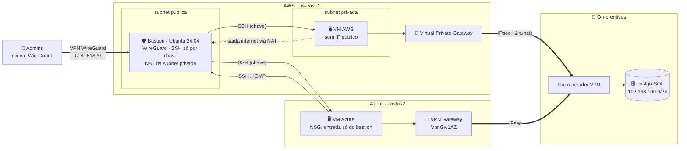
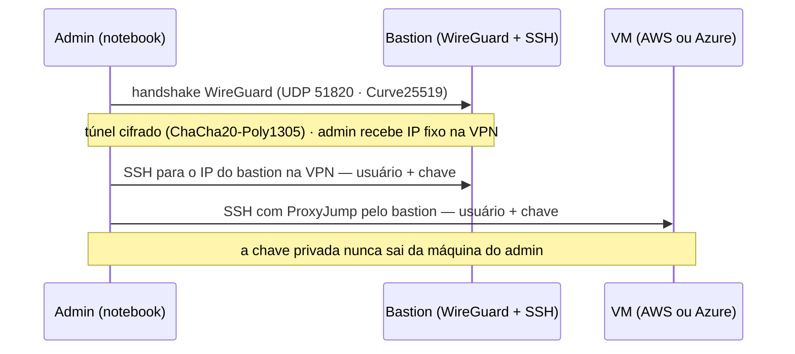
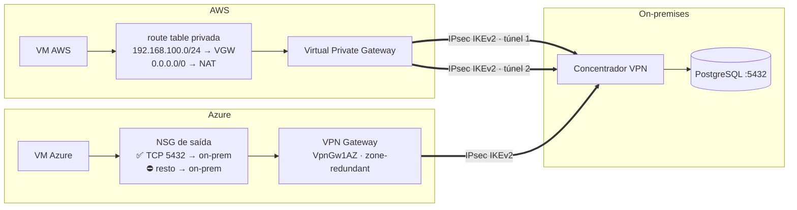
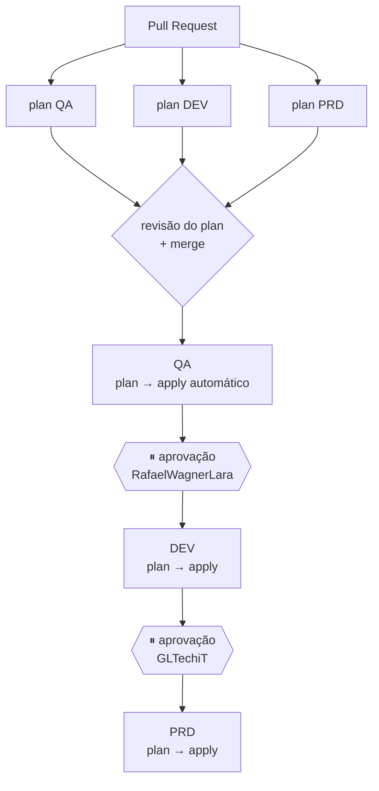
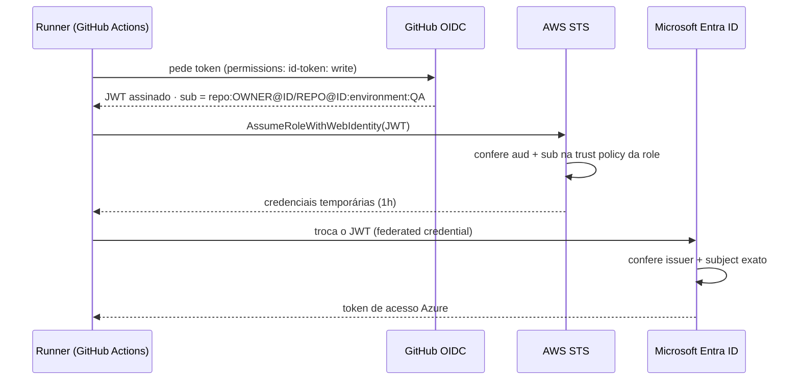

# Pipeline Multi-Cloud: AWS + Azure com Terraform e GitHub Actions

🌐 **Português** · [English](journey.md) · [Español](recorrido.md)

### Do zero ao PRD — e de volta ao zero — em um dia

> Infraestrutura em **AWS e Azure** provisionada por **Terraform**, promovida entre
> **QA → DEV → PRD** por um pipeline no **GitHub Actions**, com acesso administrativo
> exclusivamente por **VPN**, **conectividade híbrida IPsec** com o on-premises e login nas
> nuvens via **OIDC** — sem nenhuma senha ou access key guardada no GitHub.

**Autor:** Gabriel Lima ([@GLTechiT](https://github.com/GLTechiT)) — projeto pessoal de estudo, outubro/2026
**Participação:** Rafael Wagner Lara ([@RafaelWagnerLara](https://github.com/RafaelWagnerLara)),
desenvolvedor do meu time, que topou ser o aprovador do ambiente DEV — no deploy e no destroy.

---

## Sumário
1. [Objetivo](#1-objetivo)
2. [Arquitetura](#2-arquitetura)
3. [Acesso administrativo: VPN + bastion](#3-acesso-administrativo-vpn--bastion)
4. [Conectividade híbrida com o on-premises](#4-conectividade-híbrida-com-o-on-premises)
5. [Pipeline e promoção entre ambientes](#5-pipeline-e-promoção-entre-ambientes)
6. [Segurança: como nenhuma credencial ficou no GitHub](#6-segurança-como-nenhuma-credencial-ficou-no-github)
7. [Decisões de projeto e trade-offs](#7-decisões-de-projeto-e-trade-offs)
8. [Passo a passo](#8-passo-a-passo)
9. [Problemas reais e como foram resolvidos](#9-problemas-reais-e-como-foram-resolvidos)
10. [Validação](#10-validação)
11. [Custos](#11-custos)
12. [Encerramento: tudo destruído no mesmo dia](#12-encerramento-tudo-destruído-no-mesmo-dia)
13. [Próximos passos](#13-próximos-passos)
14. [Lições aprendidas](#14-lições-aprendidas)

---

## 1. Objetivo

Construir, como projeto de estudo, um fluxo **GitOps** completo:

- 1 VM Ubuntu 24.04 na **AWS** e 1 na **Azure**, por ambiente;
- um **bastion** na AWS como única porta de entrada, acessível **somente pela VPN** e
  **somente com usuário + chave**;
- **túnel IPsec** das duas nuvens até um **banco de dados on-premises**;
- 3 ambientes (**QA, DEV, PRD**) com o **mesmo código** e aprovação humana entre eles;
- tudo com **custo mínimo** e destruído no fim do dia.

Stack: **Terraform 1.16** · providers `aws` 6.x e `azurerm` 4.x · **GitHub Actions** ·
**cloud-init** · **WireGuard** · **AWS Site-to-Site VPN** · **Azure VPN Gateway** ·
**OIDC** (AWS IAM + Microsoft Entra ID).

---

## 2. Arquitetura

O mesmo desenho se repete em cada ambiente (QA, DEV, PRD), com faixas de rede próprias.



| Componente | Detalhe |
|---|---|
| **VPN de administração** | WireGuard no bastion — o único caminho de entrada dos admins. A porta 22 não é exposta à internet |
| **Bastion** | Login só com **usuário + chave**, SSH endurecido. Também faz **NAT** (iptables) para a subnet privada — substitui o NAT Gateway pago |
| **VM AWS** | Subnet privada, sem IP público; aceita SSH só do *security group* do bastion |
| **VM Azure** | O **NSG aceita entrada (SSH/ICMP) apenas do Elastic IP do bastion**. O bastion também aceita tráfego vindo dela |
| **On-premises** | VPN site-to-site **IPsec** a partir das duas nuvens até o concentrador do datacenter; as VMs acessam o PostgreSQL sem tráfego em claro na internet |
| **Usuários** | `gabriel` e `rafael` em todas as máquinas, **só chave SSH**, com `sudo` |

### Estrutura do repositório

```
bootstrap/aws        → bucket S3 do state + OIDC provider + IAM Role       (roda 1x, local)
bootstrap/azure      → App Registration + credenciais federadas + RBAC     (roda 1x, local)
terraform/           → módulo único com os providers AWS e Azure
  aws.tf  azure.tf   → rede, firewall, bastion e VMs
  onprem.tf          → VPN site-to-site IPsec (AWS + Azure)
  cloud-init.yaml.tftpl → usuários, WireGuard, hardening do SSH, NAT
  env/qa.tfvars  env/dev.tfvars  env/prd.tfvars
scripts/tf-init.sh   → terraform init apontando para o state do ambiente
.github/workflows/
  terraform.yml      → orquestra: plan nos PRs, promoção QA → DEV → PRD
  _terraform.yml     → workflow reutilizável: plan / apply / destroy
  destroy.yml        → destruição manual
```

---

## 3. Acesso administrativo: VPN + bastion



São três camadas independentes até chegar a uma VM:

1. **Rede** — o security group do bastion expõe **apenas UDP 51820** para as origens
   autorizadas. O WireGuard não responde a pacotes sem chave válida: para quem varre a
   internet, o bastion simplesmente não existe. **A porta 22 não é exposta aos admins.**
2. **Identidade na VPN** — cada admin tem um par de chaves WireGuard e um **IP fixo** na rede
   da VPN (derivado em ordem alfabética da lista de chaves). Os logs de SSH passam a mostrar
   *quem* conectou, não só "de onde".
3. **SSH** — somente **usuário + chave**: `PasswordAuthentication no`,
   `KbdInteractiveAuthentication no`, `PermitRootLogin no`, `MaxAuthTries 3`. As VMs aceitam
   SSH só a partir do bastion.

O cliente usa **split tunnel** (`AllowedIPs` = só o IP do bastion): a VPN não interfere no
resto da navegação do admin. Cada ambiente tem sua própria faixa de VPN
(`10.251/252/253.0.0/24`), permitindo túneis simultâneos para QA, DEV e PRD.

---

## 4. Conectividade híbrida com o on-premises



| Aspecto | Implementação |
|---|---|
| **Criptografia** | IKEv2 · AES-256 · SHA-256 · DH group 14 · PFS 2048 — mesma política nas duas nuvens, para o concentrador on-prem ter uma única configuração |
| **Redundância** | AWS: 2 túneis por conexão (endpoints distintos). Azure: SKU zone-redundant (`VpnGw1AZ`) |
| **Roteamento (AWS)** | A rota do on-prem é **propagada** pelo VGW na route table privada. Por ser mais específica (`/24`) que o `0.0.0.0/0` do NAT, ela vence sem precisar mexer na rota padrão |
| **Roteamento (Azure)** | *Local Network Gateway* com o prefixo on-prem; a VNet aprende a rota pelo gateway |
| **Menor privilégio** | NSG de saída libera **só TCP 5432** para a rede on-prem e nega o resto: a VM acessa o banco, não o datacenter |
| **Operação** | Os outputs entregam os IPs dos túneis para configurar o concentrador; status via `describe-vpn-connections` (AWS) e `vpn-connection show` (Azure) |
| **Custo** | Ligado por `enable_onprem_vpn` em cada `tfvars`: o VPN Gateway da Azure leva ~40 min para provisionar e tem custo por hora |

A PSK do IPsec é um **GitHub Secret** e passa por validação no Terraform (8–64 caracteres,
charset aceito pela AWS, não pode começar com `0`) — o erro aparece no `plan`, não 40
minutos depois no meio do `apply`.

---

## 5. Pipeline e promoção entre ambientes



- **PR**: roda `fmt`, `validate` e `plan` nos 3 ambientes. Nada é alterado na nuvem — o
  plan aparece no *Summary* do job para revisão.
- **Merge na `main`**: o mesmo commit é promovido. QA aplica direto; DEV e PRD esperam
  aprovação nos **GitHub Environments** (*Required reviewers*).
- O `apply` usa o **plan salvo** no job anterior: aplica exatamente o que foi revisado. Se o
  state mudou nesse meio tempo, o Terraform recusa.
- **Um state por ambiente** no S3 (`qa/`, `dev/`, `prd/terraform.tfstate`) com lock nativo
  (`use_lockfile`) — destruir QA nunca encosta em PRD.
- **Workflow reutilizável** (`workflow_call`): a lógica de plan/apply/destroy existe uma vez
  só e é chamada para cada ambiente. Runner fixado em `ubuntu-24.04`.

---

## 6. Segurança: como nenhuma credencial ficou no GitHub

### OIDC em vez de access keys



- **AWS**: IAM Role com trust policy restrita ao repositório (`sub`) e à audiência (`aud`).
- **Azure**: App Registration **sem client secret**, com 5 credenciais federadas — PR, branch
  `main` e os environments `QA`, `DEV`, `PRD`. Fora desses contextos, o token é recusado.

### Defesa em camadas (o repositório é público)

| Risco | Mitigação |
|---|---|
| SSH exposto à internet | Porta 22 fechada para os admins; acesso só pela VPN WireGuard |
| Credencial de login adivinhável | Nenhuma senha em nenhuma máquina: só usuário + chave, SSH endurecido |
| Chave privada do WireGuard / PSK do IPsec | GitHub **Secrets**; `user_data` do bastion e PSK marcados como `sensitive` (não aparecem no plan) |
| Origens autorizadas nos logs públicos | Variável `sensitive` → `(sensitive value)` no plan |
| Tráfego com o banco on-prem | IPsec AES-256 nas duas nuvens; nada em claro pela internet |
| Movimento lateral para o datacenter | NSG de saída libera só a porta do banco para a rede on-prem |
| Chave SSH vazando | Cada pessoa gera a sua; só a `.pub` vai para o GitHub; `*.key` e `*.wg.conf` no `.gitignore` |
| E-mail corporativo no histórico | Commits com o e-mail `noreply` do GitHub |
| Metadados da instância | IMDSv2 obrigatório; discos criptografados |

---

## 7. Decisões de projeto e trade-offs

| Decisão | Por quê | Trade-off |
|---|---|---|
| **Um módulo com os 2 providers** | O NSG da Azure precisa do IP do bastion (AWS) e o SG da AWS precisa do IP da VM Azure. Em states separados isso é uma **dependência circular**; num grafo único o Terraform reserva os IPs primeiro e depois cria regras e VMs | Uma falha numa nuvem bloqueia o deploy da outra |
| **WireGuard no bastion** (em vez de AWS Client VPN) | Sem custo por hora nem PKI para manter; implementação no kernel, handshake de poucos milissegundos | O bastion concentra VPN + jump host: ponto único de falha do acesso administrativo |
| **VPN site-to-site gerenciada** nas duas nuvens | SLA do provedor, 2 túneis na AWS, SKU zone-redundant na Azure; sem appliance para manter | Custo por hora e ~40 min de provisionamento na Azure → *feature flag* por ambiente |
| **Rotas estáticas no IPsec** | Concentrador on-prem mais simples; um único prefixo | Mudanças de rede on-prem exigem alterar `onprem_cidr` (BGP resolveria) |
| **Bastion como NAT instance** | NAT Gateway custa ~US$ 1/dia por ambiente | Regra de NAT não persiste após reboot |
| **Mesmo código, `tfvars` por ambiente** | Garante que PRD recebe exatamente o que foi testado em QA | — |
| **Bootstrap separado e local** | O pipeline não consegue criar a própria identidade (ovo e galinha) | State do bootstrap fica local |
| **Free tier** (`t3.micro`, `Standard_B1s`) | Custo ~zero | CPU com créditos — não serve para carga contínua |

---

## 8. Passo a passo

1. **Chaves SSH** — cada usuário gera a sua, sem passphrase:
   `ssh-keygen -t ed25519 -N "" -C "gabriel" -f ~/.ssh/gabriel.key`
2. **Chaves WireGuard** — par do servidor (a privada vai para um GitHub Secret) e um par por
   admin (`wg genkey | tee x.wg.key | wg pubkey > x.wg.pub`).
3. **Bootstrap AWS** (local) — `terraform plan -out` → revisão → `terraform apply` do plano
   salvo. Cria bucket do state (versionado, criptografado, sem acesso público), OIDC provider
   e IAM Role. **9 recursos.**
4. **Bootstrap Azure** (local) — confirmação do tenant antes de tudo (notebook corporativo!),
   depois App Registration, service principal, 5 credenciais federadas e papel Contributor.
   **8 recursos.**
5. **GitHub** — environments `QA`/`DEV`/`PRD` (aprovadores e restrição à branch `main`),
   *variables* (IDs, chaves públicas SSH e WireGuard, origens da VPN) e *secrets*
   (chave privada do WireGuard, PSK do IPsec).
6. **Primeiro push via Pull Request** — commit base só com README na `main`, infraestrutura
   numa branch → PR → planos dos 3 ambientes revisados antes de qualquer recurso existir.
7. **Merge** → QA aplicado automaticamente → aprovação de DEV pelo Rafael → aprovação de
   PRD por mim. Cada aprovação fica registrada no GitHub com autor e horário.

---

## 9. Problemas reais e como foram resolvidos

### 9.1 OIDC: `Not authorized to perform sts:AssumeRoleWithWebIdentity`

**Sintoma:** os 3 planos falharam no login da AWS.

**Diagnóstico:** em vez de ajustar a policy por tentativa e erro, consultei o **CloudTrail**,
que registra até as tentativas recusadas, com o `sub` real do token:

```bash
aws cloudtrail lookup-events \
  --lookup-attributes AttributeKey=EventName,AttributeValue=AssumeRoleWithWebIdentity \
  --query 'Events[].CloudTrailEvent' --output text | grep -oE '"userName":"[^"]*"'
```

```
Esperado pela role:  repo:GLTechiT/myfirst_pipeline:*
Enviado no token:    repo:GLTechiT@158833977/myfirst_pipeline@1419104224:pull_request
```

> Na época, o repositório se chamava `myfirst_pipeline`; depois foi renomeado para
> `multicloud-terraform-pipeline`.

**Causa:** o GitHub emite o `sub` com **IDs imutáveis** do dono e do repositório. Isso evita
que alguém recrie um repositório com o mesmo nome e herde o acesso à nuvem.

**Correção:** trust policy (AWS) e credenciais federadas (Azure) no novo formato. O plan
mostrou `1 to change` (AWS) e `5 to change` (Azure), **in-place** — nenhum ID mudou e o
GitHub não precisou de ajuste.

### 9.2 `invalid value for name (cannot begin with sg-)`

A AWS reserva o prefixo `sg-` para os IDs de security group. O `terraform validate` não pega
isso — só o provider na fase de `plan`. Nome trocado para `<projeto>-<ambiente>-bastion`,
mantendo `sg-...` apenas na tag `Name`.

### 9.3 Script sem permissão de execução vindo do Windows

O Git no Windows grava arquivos como `100644`. No runner Linux, `./tf-init.sh` daria
`Permission denied`. Solução: `git update-index --chmod=+x scripts/tf-init.sh` (conferido com
`git ls-files -s` → `100755`).

---

## 10. Validação

Roteiro de testes para validar um ambiente antes de promovê-lo:

| Camada | Teste | Esperado | Resultado |
|---|---|---|---|
| VPN | `wg show` após `wg-quick up` | *latest handshake* recente | |
| VPN | `ssh usuario@BASTION_IP_PUBLICO` (porta 22, sem VPN) | **Timeout** | |
| Bastion | `ssh -i usuario.key usuario@10.251.0.1` | Login com chave | |
| Bastion | `ssh -o PubkeyAuthentication=no usuario@10.251.0.1` | **`Permission denied (publickey)`** | |
| VM AWS | `ssh -i usuario.key -J usuario@10.251.0.1 usuario@IP_PRIVADO_AWS` | Login com chave | |
| VM AWS | `curl checkip.amazonaws.com` | IP do bastion → NAT funcionando | |
| VM Azure | `ssh -i usuario.key -J usuario@10.251.0.1 usuario@IP_AZURE` | Login com chave | |
| VM Azure | `ping` / `ssh` para o bastion | Funciona (caminho de volta) | |
| VM Azure | SSH direto, sem bastion | **Timeout** (NSG) | |
| On-prem | `nc -zv <ip-do-banco> 5432` a partir das VMs | Porta aberta via túnel | |
| On-prem | `nc -zv <ip-do-banco> 22` a partir da VM Azure | **Bloqueado** (NSG) | |
| On-prem | `describe-vpn-connections` / `vpn-connection show` | Túneis `UP` / `Connected` | |

No plan público, as origens autorizadas na VPN, o `user_data` do bastion e a PSK aparecem
como `(sensitive value)`.

---

## 11. Custos

| Item | Qtd (3 ambientes) | Free tier | Sem free tier |
|---|---|---|---|
| EC2 `t3.micro` (bastion + VM) | 6 | 750 h/mês | ~US$ 0,06/h |
| IPv4 público AWS | 3 | 750 h/mês | ~US$ 0,015/h |
| VM Azure `Standard_B1s` | 3 | 750 h/mês | ~US$ 0,03/h |
| IP público + disco Azure | 3 | parcial | ~US$ 0,02/h |
| S3 (state) | 1 | sim | centavos |
| VPN WireGuard | 3 | — | **US$ 0** (roda no bastion) |
| VPN site-to-site AWS | por ambiente habilitado | não | ~US$ 0,05/h por conexão |
| VPN Gateway Azure `VpnGw1AZ` | por ambiente habilitado | não | ~US$ 0,36/h + IP público |

**Total com a VPN site-to-site desligada: menos de US$ 1 para um dia inteiro** com os 3
ambientes no ar. A *feature flag* existe exatamente para ligar a conectividade híbrida só
onde e quando ela é necessária.

---

## 12. Encerramento: tudo destruído no mesmo dia

Ambiente de estudo não pode virar conta surpresa. A limpeza foi feita em duas etapas.

### 12.1 Ambientes (pelo pipeline)

O workflow `destroy` (manual, com confirmação digitando `destroy`) passa pelos **mesmos
gates** do deploy:

| Ambiente | Aprovação do destroy |
|---|---|
| QA | automática |
| DEV | Rafael — e **só ele** podia aprovar: nem o dono do repositório passa por cima do gate |
| PRD | eu |

A governança vale nos dois sentidos: quem pode criar em DEV é quem pode destruir em DEV.

### 12.2 Bootstrap (local)

1. `terraform plan -destroy` nos dois bootstraps para revisar: **9 recursos AWS, 8 Azure** —
   exatamente o que tinha sido criado.
2. O bucket do state é **versionado** e protegido com `force_destroy = false`; o Terraform
   recusa apagar bucket com conteúdo. Foi preciso remover todas as versões e marcadores de
   exclusão antes (eram 43 versões e 18 marcadores — cada `apply` gera uma versão do state).
3. `terraform destroy` nos dois bootstraps.

### 12.3 Conferência independente

Em vez de confiar só no "Destroy complete", conferi direto nas nuvens:

| Verificação | Resultado |
|---|---|
| Bucket S3, IAM Role, OIDC provider | não existem |
| Instâncias, Elastic IPs, VPCs, volumes EBS | 0 |
| App Registration e role assignments na Azure | 0 |
| Resource groups do projeto | nenhum |

Os resource groups que já existiam na assinatura antes do projeto (incluindo o
`NetworkWatcherRG`, criado automaticamente pela Azure) foram identificados pela data de
criação e **não foram tocados**.

---

## 13. Próximos passos

### Load balancer com SSL válido (em avaliação)

As VMs estão em **duas nuvens**: um load balancer gerenciado de uma nuvem não alcança VMs da
outra sem conectividade privada. Opções levantadas:

| | A) HAProxy no bastion | B) LB por nuvem + DNS (Route 53) | C) Cloudflare na frente |
|---|---|---|---|
| SSL | Let's Encrypt | ACM (AWS) + Let's Encrypt (Azure) | Cloudflare |
| Custo | ~US$ 0 | ~US$ 1–2/ambiente/dia | US$ 0 (LB: US$ 5/mês) |
| Alta disponibilidade | ❌ ponto único | ✅ failover entre nuvens | ✅ |
| Complexidade | Baixa | Alta | Média |

Pré-requisito em qualquer caso: **um domínio** — certificados confiáveis são emitidos para
nomes, não para IPs. E um LB distribui carga e dá alta disponibilidade, mas não acelera a
requisição: para desempenho, o tamanho das VMs e uma CDN pesam mais.

### Outras melhorias
- Chave privada do WireGuard buscada do **Secrets Manager** via instance profile, em vez de
  `user_data`.
- **BGP** na VPN site-to-site e gateway Azure **active-active**.
- Tráfego administrativo bastion ↔ Azure também por túnel privado.
- Atualizar actions para versões em Node 24 (`checkout`, `configure-aws-credentials`).
- Permissões mínimas: role AWS sem `AmazonEC2FullAccess`; Contributor só em resource groups.
- Contas/assinaturas separadas por ambiente.
- `terraform plan` comentado automaticamente no PR.

---

## 14. Lições aprendidas

1. **Leia o plan antes do apply — sempre.** `0 to destroy` e `update in-place` são as linhas
   que mais importam.
2. **Diagnostique com dados, não com palpites.** O CloudTrail mostrou o `sub` exato em
   segundos.
3. **OIDC > secrets.** Nada para vazar, nada para rotacionar.
4. **Defesa em camadas.** VPN → chave SSH → bastion → firewall por VM → menor privilégio até
   o banco on-prem. Nenhuma camada sozinha é o controle.
5. **Valide cedo o que é caro de errar.** Uma PSK inválida descoberta no `plan` custa
   segundos; no meio de um VPN Gateway, custa 40 minutos.
6. **O primeiro deploy é via PR.** Ver o plano dos 3 ambientes antes de qualquer recurso
   existir dá segurança para o merge.
7. **Repositório público muda tudo:** e-mail de commit, IPs nos logs, chaves e PSK — cada
   detalhe precisa de uma decisão consciente.
8. **Destruir também é processo.** Gates no destroy, plano de destruição revisado e
   conferência independente no final — "Destroy complete" não é prova.
