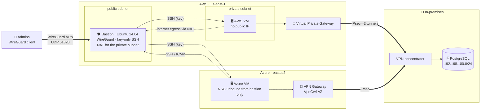
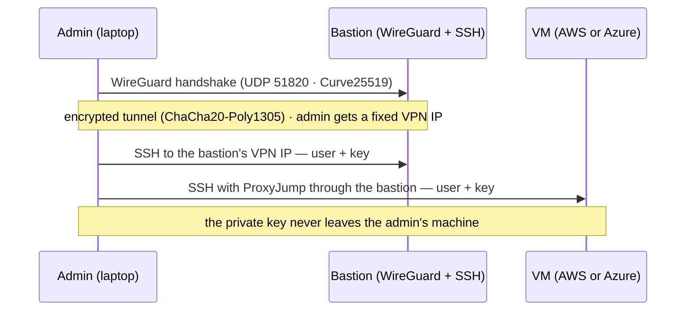
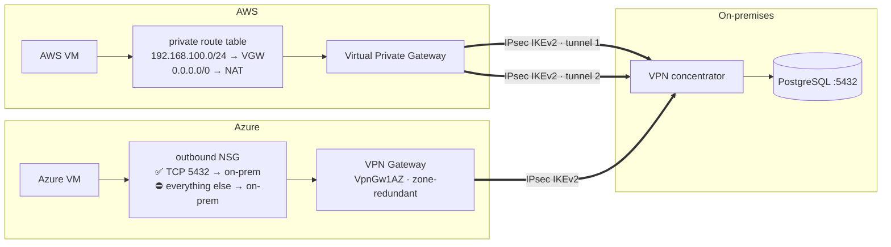
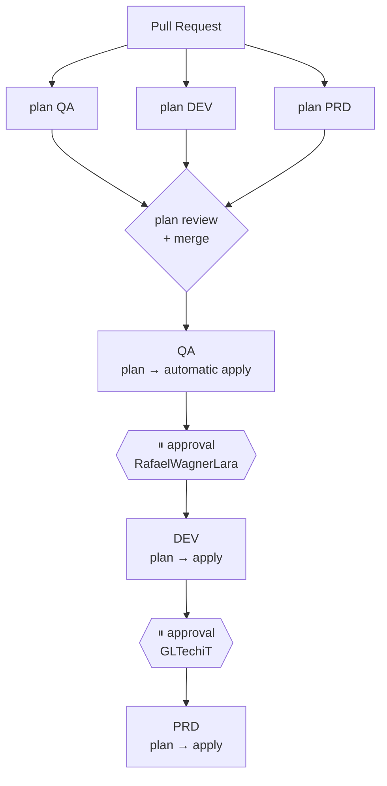
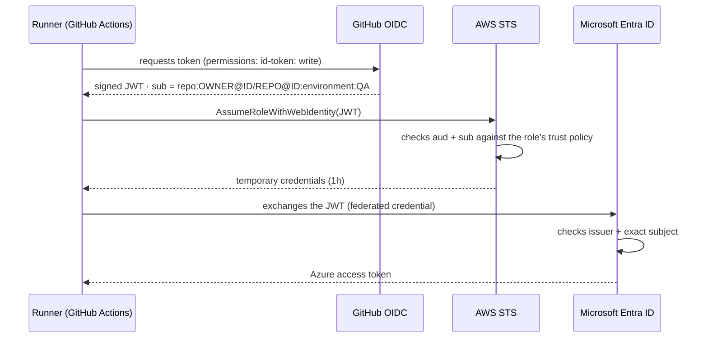

# Multi-Cloud Pipeline: AWS + Azure with Terraform and GitHub Actions

🌐 [Português](jornada.md) · **English** · [Español](recorrido.md)

### From zero to PRD — and back to zero — in one day

> Infrastructure on **AWS and Azure** provisioned with **Terraform**, promoted across
> **QA → DEV → PRD** by a **GitHub Actions** pipeline, with administrative access
> exclusively through a **VPN**, **IPsec hybrid connectivity** to on-premises and cloud
> login via **OIDC** — no passwords or access keys stored in GitHub.

**Author:** Gabriel Lima ([@GLTechiT](https://github.com/GLTechiT)) — personal study project, October 2026
**Contributor:** Rafael Wagner Lara ([@RafaelWagnerLara](https://github.com/RafaelWagnerLara)),
a developer on my team who volunteered as the approver for the DEV environment — for both deploy and destroy.

---

## Contents
1. [Goal](#1-goal)
2. [Architecture](#2-architecture)
3. [Administrative access: VPN + bastion](#3-administrative-access-vpn--bastion)
4. [Hybrid connectivity to on-premises](#4-hybrid-connectivity-to-on-premises)
5. [Pipeline and environment promotion](#5-pipeline-and-environment-promotion)
6. [Security: how no credentials ended up in GitHub](#6-security-how-no-credentials-ended-up-in-github)
7. [Design decisions and trade-offs](#7-design-decisions-and-trade-offs)
8. [Step by step](#8-step-by-step)
9. [Real problems and how they were solved](#9-real-problems-and-how-they-were-solved)
10. [Validation](#10-validation)
11. [Costs](#11-costs)
12. [Wrap-up: everything destroyed the same day](#12-wrap-up-everything-destroyed-the-same-day)
13. [Next steps](#13-next-steps)
14. [Lessons learned](#14-lessons-learned)

---

## 1. Goal

Build a complete **GitOps** workflow as a study project:

- 1 Ubuntu 24.04 VM on **AWS** and 1 on **Azure**, per environment;
- a **bastion** on AWS as the single entry point, reachable **only through the VPN** and
  **only with user + key**;
- an **IPsec tunnel** from both clouds to an **on-premises database**;
- 3 environments (**QA, DEV, PRD**) running the **same code**, with human approval between them;
- everything at **minimum cost** and torn down at the end of the day.

Stack: **Terraform 1.16** · `aws` 6.x and `azurerm` 4.x providers · **GitHub Actions** ·
**cloud-init** · **WireGuard** · **AWS Site-to-Site VPN** · **Azure VPN Gateway** ·
**OIDC** (AWS IAM + Microsoft Entra ID).

---

## 2. Architecture

The same layout is repeated in each environment (QA, DEV, PRD), each with its own network ranges.



| Component | Details |
|---|---|
| **Admin VPN** | WireGuard on the bastion — the only way in for admins. Port 22 is not exposed to the internet |
| **Bastion** | **User + key** login only, hardened SSH. Also performs **NAT** (iptables) for the private subnet — replacing the paid NAT Gateway |
| **AWS VM** | Private subnet, no public IP; accepts SSH only from the bastion's *security group* |
| **Azure VM** | The **NSG accepts inbound (SSH/ICMP) only from the bastion's Elastic IP**. The bastion also accepts traffic from it |
| **On-premises** | **IPsec** site-to-site VPN from both clouds to the datacenter's concentrator; the VMs reach PostgreSQL with no clear-text traffic over the internet |
| **Users** | `gabriel` and `rafael` on every machine, **SSH key only**, with `sudo` |

### Repository layout

```
bootstrap/aws        → S3 state bucket + OIDC provider + IAM Role          (run once, locally)
bootstrap/azure      → App Registration + federated credentials + RBAC    (run once, locally)
terraform/           → single module with both AWS and Azure providers
  aws.tf  azure.tf   → network, firewall, bastion and VMs
  onprem.tf          → IPsec site-to-site VPN (AWS + Azure)
  cloud-init.yaml.tftpl → users, WireGuard, SSH hardening, NAT
  env/qa.tfvars  env/dev.tfvars  env/prd.tfvars
scripts/tf-init.sh   → terraform init pointing at the environment's state
.github/workflows/
  terraform.yml      → orchestrator: plan on PRs, QA → DEV → PRD promotion
  _terraform.yml     → reusable workflow: plan / apply / destroy
  destroy.yml        → manual teardown
```

---

## 3. Administrative access: VPN + bastion



There are three independent layers before reaching a VM:

1. **Network** — the bastion's security group exposes **only UDP 51820** to authorized
   sources. WireGuard does not respond to packets without a valid key: to internet scanners,
   the bastion simply does not exist. **Port 22 is not exposed to admins.**
2. **VPN identity** — each admin has a WireGuard key pair and a **fixed IP** on the VPN
   network (derived alphabetically from the key list). SSH logs now show *who* connected,
   not just "from where".
3. **SSH** — **user + key** only: `PasswordAuthentication no`,
   `KbdInteractiveAuthentication no`, `PermitRootLogin no`, `MaxAuthTries 3`. The VMs accept
   SSH only from the bastion.

The client uses a **split tunnel** (`AllowedIPs` = the bastion's IP only): the VPN doesn't
interfere with the rest of the admin's traffic. Each environment has its own VPN range
(`10.251/252/253.0.0/24`), allowing simultaneous tunnels to QA, DEV and PRD.

---

## 4. Hybrid connectivity to on-premises



| Aspect | Implementation |
|---|---|
| **Encryption** | IKEv2 · AES-256 · SHA-256 · DH group 14 · PFS 2048 — the same policy in both clouds, so the on-prem concentrator has a single configuration |
| **Redundancy** | AWS: 2 tunnels per connection (distinct endpoints). Azure: zone-redundant SKU (`VpnGw1AZ`) |
| **Routing (AWS)** | The on-prem route is **propagated** by the VGW into the private route table. Being more specific (`/24`) than the NAT's `0.0.0.0/0`, it wins without touching the default route |
| **Routing (Azure)** | *Local Network Gateway* with the on-prem prefix; the VNet learns the route through the gateway |
| **Least privilege** | The outbound NSG allows **only TCP 5432** to the on-prem network and denies everything else: the VM reaches the database, not the datacenter |
| **Operations** | Outputs provide the tunnel IPs to configure the concentrator; status via `describe-vpn-connections` (AWS) and `vpn-connection show` (Azure) |
| **Cost** | Enabled per `tfvars` through `enable_onprem_vpn`: the Azure VPN Gateway takes ~40 min to provision and is billed hourly |

The IPsec PSK is a **GitHub Secret** and is validated in Terraform (8–64 characters, charset
accepted by AWS, cannot start with `0`) — the error shows up at `plan`, not 40 minutes into
an `apply`.

---

## 5. Pipeline and environment promotion



- **PR**: runs `fmt`, `validate` and `plan` for all 3 environments. Nothing changes in the
  cloud — the plan is shown in the job *Summary* for review.
- **Merge to `main`**: the same commit is promoted. QA applies right away; DEV and PRD wait
  for approval in **GitHub Environments** (*Required reviewers*).
- `apply` uses the **plan saved** by the previous job: it applies exactly what was reviewed.
  If the state changed in the meantime, Terraform refuses.
- **One state per environment** in S3 (`qa/`, `dev/`, `prd/terraform.tfstate`) with native
  locking (`use_lockfile`) — destroying QA never touches PRD.
- **Reusable workflow** (`workflow_call`): the plan/apply/destroy logic exists only once and
  is called for each environment. Runner pinned to `ubuntu-24.04`.

---

## 6. Security: how no credentials ended up in GitHub

### OIDC instead of access keys



- **AWS**: IAM Role whose trust policy is restricted to the repository (`sub`) and the
  audience (`aud`).
- **Azure**: App Registration **with no client secret**, with 5 federated credentials — PR,
  `main` branch and the `QA`, `DEV`, `PRD` environments. Outside those contexts the token is
  rejected.

### Defense in depth (the repository is public)

| Risk | Mitigation |
|---|---|
| SSH exposed to the internet | Port 22 closed to admins; access only through the WireGuard VPN |
| Guessable login credential | No password on any machine: user + key only, hardened SSH |
| WireGuard private key / IPsec PSK | GitHub **Secrets**; the bastion's `user_data` and the PSK are `sensitive` (hidden from the plan) |
| Authorized sources in public logs | `sensitive` variable → `(sensitive value)` in the plan |
| Traffic to the on-prem database | AES-256 IPsec from both clouds; nothing in clear text over the internet |
| Lateral movement into the datacenter | Outbound NSG allows only the database port to the on-prem network |
| SSH key leaking | Each person generates their own; only the `.pub` goes to GitHub; `*.key` and `*.wg.conf` in `.gitignore` |
| Work e-mail in the history | Commits use GitHub's `noreply` e-mail |
| Instance metadata | IMDSv2 required; encrypted disks |

---

## 7. Design decisions and trade-offs

| Decision | Why | Trade-off |
|---|---|---|
| **One module with both providers** | The Azure NSG needs the bastion's IP (AWS) and the AWS SG needs the Azure VM's IP. With separate states that's a **circular dependency**; in a single graph Terraform reserves the IPs first and then creates rules and VMs | A failure in one cloud blocks deploys to the other |
| **WireGuard on the bastion** (instead of AWS Client VPN) | No hourly cost and no PKI to maintain; in-kernel implementation, millisecond handshakes | The bastion hosts both VPN and jump host: a single point of failure for admin access |
| **Managed site-to-site VPN** in both clouds | Provider SLA, 2 tunnels on AWS, zone-redundant SKU on Azure; no appliance to maintain | Hourly cost and ~40 min provisioning on Azure → per-environment *feature flag* |
| **Static routes on IPsec** | Simpler on-prem concentrator; a single prefix | On-prem network changes require updating `onprem_cidr` (BGP would solve it) |
| **Bastion as a NAT instance** | A NAT Gateway costs ~US$1/day per environment | NAT rule does not survive a reboot |
| **Same code, per-environment `tfvars`** | Guarantees PRD gets exactly what was tested in QA | — |
| **Separate, local bootstrap** | The pipeline can't create its own identity (chicken and egg) | Bootstrap state stays local |
| **Free tier** (`t3.micro`, `Standard_B1s`) | ~Zero cost | Burstable CPU — not suitable for sustained load |

---

## 8. Step by step

1. **SSH keys** — each user generates their own, without a passphrase:
   `ssh-keygen -t ed25519 -N "" -C "gabriel" -f ~/.ssh/gabriel.key`
2. **WireGuard keys** — a server pair (the private key goes into a GitHub Secret) and one pair
   per admin (`wg genkey | tee x.wg.key | wg pubkey > x.wg.pub`).
3. **AWS bootstrap** (local) — `terraform plan -out` → review → `terraform apply` of the saved
   plan. Creates the state bucket (versioned, encrypted, no public access), the OIDC provider
   and the IAM Role. **9 resources.**
4. **Azure bootstrap** (local) — tenant confirmation first (corporate laptop!), then App
   Registration, service principal, 5 federated credentials and the Contributor role.
   **8 resources.**
5. **GitHub** — `QA`/`DEV`/`PRD` environments (reviewers and restriction to the `main`
   branch), *variables* (IDs, SSH and WireGuard public keys, VPN sources) and *secrets*
   (WireGuard private key, IPsec PSK).
6. **First push through a Pull Request** — a base commit with just the README on `main`, the
   infrastructure on a branch → PR → plans for all 3 environments reviewed before any
   resource existed.
7. **Merge** → QA applied automatically → DEV approved by Rafael → PRD approved by me. Every
   approval is recorded in GitHub with author and timestamp.

---

## 9. Real problems and how they were solved

### 9.1 OIDC: `Not authorized to perform sts:AssumeRoleWithWebIdentity`

**Symptom:** all 3 plans failed at the AWS login.

**Diagnosis:** instead of adjusting the policy by trial and error, I queried **CloudTrail**,
which logs even rejected attempts, including the token's actual `sub`:

```bash
aws cloudtrail lookup-events \
  --lookup-attributes AttributeKey=EventName,AttributeValue=AssumeRoleWithWebIdentity \
  --query 'Events[].CloudTrailEvent' --output text | grep -oE '"userName":"[^"]*"'
```

```
Expected by the role:  repo:GLTechiT/myfirst_pipeline:*
Sent in the token:     repo:GLTechiT@158833977/myfirst_pipeline@1419104224:pull_request
```

> At the time, the repository was named `myfirst_pipeline`; it was later renamed to
> `multicloud-terraform-pipeline`.

**Cause:** GitHub issues the `sub` with the owner's and repository's **immutable IDs**. This
prevents someone from recreating a repository with the same name and inheriting cloud access.

**Fix:** trust policy (AWS) and federated credentials (Azure) updated to the new format. The
plan showed `1 to change` (AWS) and `5 to change` (Azure), **in-place** — no IDs changed and
nothing had to be updated in GitHub.

### 9.2 `invalid value for name (cannot begin with sg-)`

AWS reserves the `sg-` prefix for security group IDs. `terraform validate` doesn't catch this
— only the provider does, during `plan`. The name was changed to `<project>-<environment>-bastion`,
keeping `sg-...` only in the `Name` tag.

### 9.3 Script without execute permission coming from Windows

Git on Windows stores files as `100644`. On the Linux runner, `./tf-init.sh` would fail with
`Permission denied`. Fix: `git update-index --chmod=+x scripts/tf-init.sh` (verified with
`git ls-files -s` → `100755`).

---

## 10. Validation

Test checklist to validate an environment before promoting it:

| Layer | Test | Expected | Result |
|---|---|---|---|
| VPN | `wg show` after `wg-quick up` | recent *latest handshake* | |
| VPN | `ssh user@BASTION_PUBLIC_IP` (port 22, no VPN) | **Timeout** | |
| Bastion | `ssh -i user.key user@10.251.0.1` | Key login | |
| Bastion | `ssh -o PubkeyAuthentication=no user@10.251.0.1` | **`Permission denied (publickey)`** | |
| AWS VM | `ssh -i user.key -J user@10.251.0.1 user@AWS_PRIVATE_IP` | Key login | |
| AWS VM | `curl checkip.amazonaws.com` | Bastion's IP → NAT working | |
| Azure VM | `ssh -i user.key -J user@10.251.0.1 user@AZURE_IP` | Key login | |
| Azure VM | `ping` / `ssh` to the bastion | Works (return path) | |
| Azure VM | Direct SSH, bypassing the bastion | **Timeout** (NSG) | |
| On-prem | `nc -zv <db-ip> 5432` from the VMs | Port open through the tunnel | |
| On-prem | `nc -zv <db-ip> 22` from the Azure VM | **Blocked** (NSG) | |
| On-prem | `describe-vpn-connections` / `vpn-connection show` | Tunnels `UP` / `Connected` | |

In the public plan, the authorized VPN sources, the bastion's `user_data` and the PSK show up
as `(sensitive value)`.

---

## 11. Costs

| Item | Qty (3 environments) | Free tier | Without free tier |
|---|---|---|---|
| EC2 `t3.micro` (bastion + VM) | 6 | 750 h/month | ~US$0.06/h |
| AWS public IPv4 | 3 | 750 h/month | ~US$0.015/h |
| Azure VM `Standard_B1s` | 3 | 750 h/month | ~US$0.03/h |
| Azure public IP + disk | 3 | partial | ~US$0.02/h |
| S3 (state) | 1 | yes | cents |
| WireGuard VPN | 3 | — | **US$0** (runs on the bastion) |
| AWS site-to-site VPN | per enabled environment | no | ~US$0.05/h per connection |
| Azure VPN Gateway `VpnGw1AZ` | per enabled environment | no | ~US$0.36/h + public IP |

**Total with the site-to-site VPN disabled: less than US$1 for a full day** with all 3
environments running. The *feature flag* exists precisely to turn on hybrid connectivity
only where and when it's needed.

---

## 12. Wrap-up: everything destroyed the same day

A study environment must not turn into a surprise bill. Cleanup was done in two stages.

### 12.1 Environments (through the pipeline)

The `destroy` workflow (manual, confirmed by typing `destroy`) goes through the **same
gates** as the deploy:

| Environment | Destroy approval |
|---|---|
| QA | automatic |
| DEV | Rafael — and **only he** could approve: not even the repository owner can bypass the gate |
| PRD | me |

Governance works both ways: whoever can create in DEV is whoever can destroy in DEV.

### 12.2 Bootstrap (local)

1. `terraform plan -destroy` on both bootstraps for review: **9 AWS resources, 8 Azure** —
   exactly what had been created.
2. The state bucket is **versioned** and protected with `force_destroy = false`; Terraform
   refuses to delete a non-empty bucket. Every version and delete marker had to be removed
   first (43 versions and 18 markers — every `apply` creates a new state version).
3. `terraform destroy` on both bootstraps.

### 12.3 Independent verification

Rather than trusting "Destroy complete" alone, I checked the clouds directly:

| Check | Result |
|---|---|
| S3 bucket, IAM Role, OIDC provider | gone |
| Instances, Elastic IPs, VPCs, EBS volumes | 0 |
| Azure App Registration and role assignments | 0 |
| Project resource groups | none |

Resource groups that already existed in the subscription before the project (including
`NetworkWatcherRG`, created automatically by Azure) were identified by their creation date
and **left untouched**.

---

## 13. Next steps

### Load balancer with a valid SSL certificate (under evaluation)

The VMs live in **two clouds**: a managed load balancer in one cloud can't reach VMs in the
other without private connectivity. Options considered:

| | A) HAProxy on the bastion | B) Per-cloud LB + DNS (Route 53) | C) Cloudflare in front |
|---|---|---|---|
| SSL | Let's Encrypt | ACM (AWS) + Let's Encrypt (Azure) | Cloudflare |
| Cost | ~US$0 | ~US$1–2/environment/day | US$0 (LB: US$5/month) |
| High availability | ❌ single point | ✅ cross-cloud failover | ✅ |
| Complexity | Low | High | Medium |

Prerequisite in every case: **a domain** — trusted certificates are issued for names, not
IPs. And a load balancer spreads load and adds high availability, but it doesn't make a single
request faster: for performance, VM size and a CDN matter more.

### Other improvements
- Fetch the WireGuard private key from **Secrets Manager** through an instance profile
  instead of `user_data`.
- **BGP** on the site-to-site VPN and an **active-active** Azure gateway.
- Move bastion ↔ Azure administrative traffic onto a private tunnel as well.
- Upgrade actions to Node 24 versions (`checkout`, `configure-aws-credentials`).
- Least privilege: AWS role without `AmazonEC2FullAccess`; Contributor scoped to resource groups.
- Separate accounts/subscriptions per environment.
- `terraform plan` posted automatically as a PR comment.

---

## 14. Lessons learned

1. **Read the plan before applying — always.** `0 to destroy` and `update in-place` are the
   lines that matter most.
2. **Diagnose with data, not guesses.** CloudTrail showed the exact `sub` in seconds.
3. **OIDC > secrets.** Nothing to leak, nothing to rotate.
4. **Defense in depth.** VPN → SSH key → bastion → per-VM firewall → least privilege down to
   the on-prem database. No single layer is the control.
5. **Validate early whatever is expensive to get wrong.** An invalid PSK caught at `plan`
   costs seconds; halfway through a VPN Gateway, it costs 40 minutes.
6. **The first deploy goes through a PR.** Seeing the plan for all 3 environments before any
   resource exists makes merging safe.
7. **A public repository changes everything:** commit e-mail, IPs in logs, keys and PSKs —
   every detail needs a conscious decision.
8. **Destroying is a process too.** Gates on destroy, a reviewed destroy plan and independent
   verification at the end — "Destroy complete" is not proof.
