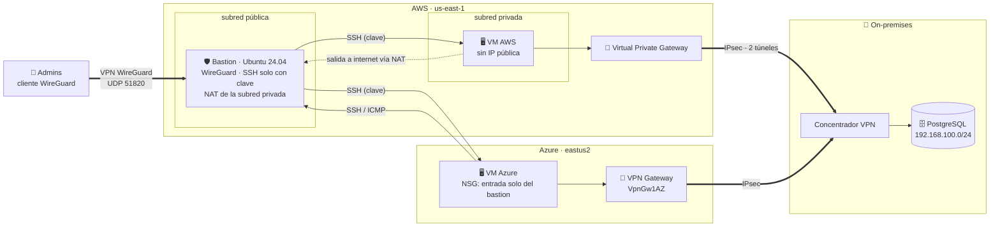
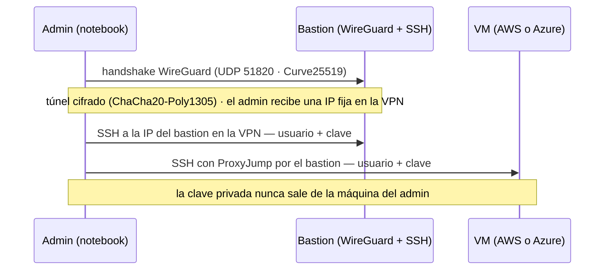
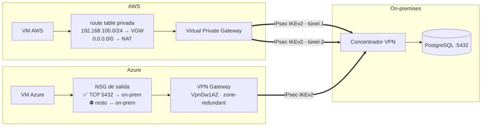
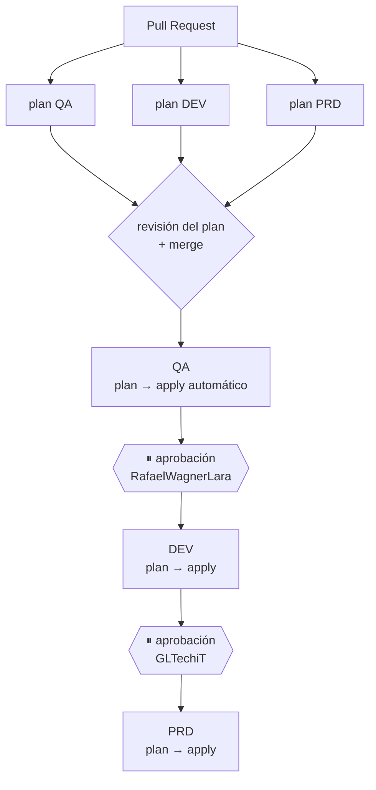
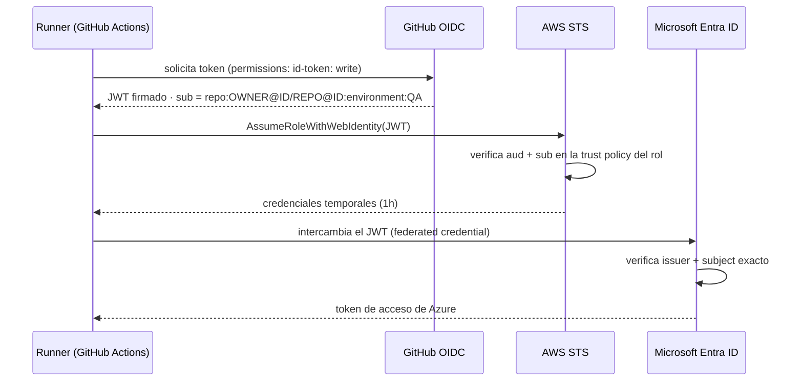

# Pipeline Multi-Cloud: AWS + Azure con Terraform y GitHub Actions

🌐 [Português](jornada.md) · [English](journey.md) · **Español**

### De cero a PRD — y de vuelta a cero — en un día

> Infraestructura en **AWS y Azure** aprovisionada con **Terraform**, promovida entre
> **QA → DEV → PRD** por un pipeline en **GitHub Actions**, con acceso administrativo
> exclusivamente por **VPN**, **conectividad híbrida IPsec** con el on-premises e inicio de
> sesión en las nubes vía **OIDC** — sin ninguna contraseña ni access key guardada en GitHub.

**Autor:** Gabriel Lima ([@GLTechiT](https://github.com/GLTechiT)) — proyecto personal de estudio, octubre de 2026
**Participación:** Rafael Wagner Lara ([@RafaelWagnerLara](https://github.com/RafaelWagnerLara)),
desarrollador de mi equipo, que aceptó ser el aprobador del entorno DEV — en el deploy y en el destroy.

---

## Contenido
1. [Objetivo](#1-objetivo)
2. [Arquitectura](#2-arquitectura)
3. [Acceso administrativo: VPN + bastion](#3-acceso-administrativo-vpn--bastion)
4. [Conectividad híbrida con el on-premises](#4-conectividad-híbrida-con-el-on-premises)
5. [Pipeline y promoción entre entornos](#5-pipeline-y-promoción-entre-entornos)
6. [Seguridad: cómo ninguna credencial quedó en GitHub](#6-seguridad-cómo-ninguna-credencial-quedó-en-github)
7. [Decisiones de diseño y trade-offs](#7-decisiones-de-diseño-y-trade-offs)
8. [Paso a paso](#8-paso-a-paso)
9. [Problemas reales y cómo se resolvieron](#9-problemas-reales-y-cómo-se-resolvieron)
10. [Validación](#10-validación)
11. [Costos](#11-costos)
12. [Cierre: todo destruido el mismo día](#12-cierre-todo-destruido-el-mismo-día)
13. [Próximos pasos](#13-próximos-pasos)
14. [Lecciones aprendidas](#14-lecciones-aprendidas)

---

## 1. Objetivo

Construir, como proyecto de estudio, un flujo **GitOps** completo:

- 1 VM Ubuntu 24.04 en **AWS** y 1 en **Azure**, por entorno;
- un **bastion** en AWS como único punto de entrada, accesible **solo por la VPN** y
  **solo con usuario + clave**;
- **túnel IPsec** desde ambas nubes hasta una **base de datos on-premises**;
- 3 entornos (**QA, DEV, PRD**) con el **mismo código** y aprobación humana entre ellos;
- todo con **costo mínimo** y destruido al final del día.

Stack: **Terraform 1.16** · providers `aws` 6.x y `azurerm` 4.x · **GitHub Actions** ·
**cloud-init** · **WireGuard** · **AWS Site-to-Site VPN** · **Azure VPN Gateway** ·
**OIDC** (AWS IAM + Microsoft Entra ID).

---

## 2. Arquitectura

El mismo diseño se repite en cada entorno (QA, DEV, PRD), cada uno con sus propios rangos de red.



| Componente | Detalle |
|---|---|
| **VPN de administración** | WireGuard en el bastion — el único camino de entrada de los admins. El puerto 22 no está expuesto a internet |
| **Bastion** | Inicio de sesión solo con **usuario + clave**, SSH endurecido. También hace **NAT** (iptables) para la subred privada — reemplaza al NAT Gateway de pago |
| **VM AWS** | Subred privada, sin IP pública; acepta SSH solo desde el *security group* del bastion |
| **VM Azure** | El **NSG acepta entrada (SSH/ICMP) solo desde la Elastic IP del bastion**. El bastion también acepta tráfico proveniente de ella |
| **On-premises** | VPN site-to-site **IPsec** desde ambas nubes hasta el concentrador del datacenter; las VMs acceden a PostgreSQL sin tráfico en claro por internet |
| **Usuarios** | `gabriel` y `rafael` en todas las máquinas, **solo clave SSH**, con `sudo` |

### Estructura del repositorio

```
bootstrap/aws        → bucket S3 del state + OIDC provider + IAM Role          (se ejecuta 1 vez, local)
bootstrap/azure      → App Registration + credenciales federadas + RBAC       (se ejecuta 1 vez, local)
terraform/           → módulo único con los providers de AWS y Azure
  aws.tf  azure.tf   → red, firewall, bastion y VMs
  onprem.tf          → VPN site-to-site IPsec (AWS + Azure)
  cloud-init.yaml.tftpl → usuarios, WireGuard, hardening de SSH, NAT
  env/qa.tfvars  env/dev.tfvars  env/prd.tfvars
scripts/tf-init.sh   → terraform init apuntando al state del entorno
.github/workflows/
  terraform.yml      → orquesta: plan en los PRs, promoción QA → DEV → PRD
  _terraform.yml     → workflow reutilizable: plan / apply / destroy
  destroy.yml        → destrucción manual
```

---

## 3. Acceso administrativo: VPN + bastion



Hay tres capas independientes antes de llegar a una VM:

1. **Red** — el security group del bastion expone **solo UDP 51820** a los orígenes
   autorizados. WireGuard no responde a paquetes sin una clave válida: para quien escanea
   internet, el bastion simplemente no existe. **El puerto 22 no está expuesto a los admins.**
2. **Identidad en la VPN** — cada admin tiene un par de claves WireGuard y una **IP fija** en
   la red de la VPN (asignada en orden alfabético a partir de la lista de claves). Los logs de
   SSH pasan a mostrar *quién* se conectó, no solo "desde dónde".
3. **SSH** — solo **usuario + clave**: `PasswordAuthentication no`,
   `KbdInteractiveAuthentication no`, `PermitRootLogin no`, `MaxAuthTries 3`. Las VMs aceptan
   SSH solo desde el bastion.

El cliente usa **split tunnel** (`AllowedIPs` = solo la IP del bastion): la VPN no interfiere
con el resto del tráfico del admin. Cada entorno tiene su propio rango de VPN
(`10.251/252/253.0.0/24`), lo que permite túneles simultáneos a QA, DEV y PRD.

---

## 4. Conectividad híbrida con el on-premises



| Aspecto | Implementación |
|---|---|
| **Cifrado** | IKEv2 · AES-256 · SHA-256 · DH group 14 · PFS 2048 — la misma política en ambas nubes, para que el concentrador on-prem tenga una única configuración |
| **Redundancia** | AWS: 2 túneles por conexión (endpoints distintos). Azure: SKU zone-redundant (`VpnGw1AZ`) |
| **Enrutamiento (AWS)** | La ruta del on-prem se **propaga** desde el VGW a la route table privada. Al ser más específica (`/24`) que el `0.0.0.0/0` del NAT, gana sin tocar la ruta por defecto |
| **Enrutamiento (Azure)** | *Local Network Gateway* con el prefijo on-prem; la VNet aprende la ruta a través del gateway |
| **Mínimo privilegio** | El NSG de salida permite **solo TCP 5432** hacia la red on-prem y niega el resto: la VM accede a la base de datos, no al datacenter |
| **Operación** | Los outputs entregan las IPs de los túneles para configurar el concentrador; estado vía `describe-vpn-connections` (AWS) y `vpn-connection show` (Azure) |
| **Costo** | Se activa con `enable_onprem_vpn` en cada `tfvars`: el VPN Gateway de Azure tarda ~40 min en aprovisionarse y se cobra por hora |

La PSK del IPsec es un **Secret** de GitHub y pasa por validación en Terraform (8–64
caracteres, juego de caracteres aceptado por AWS, no puede empezar con `0`) — el error aparece
en el `plan`, no 40 minutos después en medio del `apply`.

---

## 5. Pipeline y promoción entre entornos



- **PR**: ejecuta `fmt`, `validate` y `plan` en los 3 entornos. Nada cambia en la nube — el
  plan aparece en el *Summary* del job para revisión.
- **Merge a `main`**: se promueve el mismo commit. QA aplica directamente; DEV y PRD esperan
  aprobación en los **GitHub Environments** (*Required reviewers*).
- El `apply` usa el **plan guardado** por el job anterior: aplica exactamente lo que se revisó.
  Si el state cambió mientras tanto, Terraform lo rechaza.
- **Un state por entorno** en S3 (`qa/`, `dev/`, `prd/terraform.tfstate`) con bloqueo nativo
  (`use_lockfile`) — destruir QA nunca toca PRD.
- **Workflow reutilizable** (`workflow_call`): la lógica de plan/apply/destroy existe una sola
  vez y se llama para cada entorno. Runner fijado en `ubuntu-24.04`.

---

## 6. Seguridad: cómo ninguna credencial quedó en GitHub

### OIDC en lugar de access keys



- **AWS**: IAM Role con trust policy restringida al repositorio (`sub`) y a la audiencia (`aud`).
- **Azure**: App Registration **sin client secret**, con 5 credenciales federadas — PR, rama
  `main` y los entornos `QA`, `DEV`, `PRD`. Fuera de esos contextos, el token es rechazado.

### Defensa en capas (el repositorio es público)

| Riesgo | Mitigación |
|---|---|
| SSH expuesto a internet | Puerto 22 cerrado para los admins; acceso solo por la VPN WireGuard |
| Credencial de acceso adivinable | Ninguna contraseña en ninguna máquina: solo usuario + clave, SSH endurecido |
| Clave privada de WireGuard / PSK del IPsec | **Secrets** de GitHub; el `user_data` del bastion y la PSK marcados como `sensitive` (no aparecen en el plan) |
| Orígenes autorizados en logs públicos | Variable `sensitive` → `(sensitive value)` en el plan |
| Tráfico con la base de datos on-prem | IPsec AES-256 desde ambas nubes; nada en claro por internet |
| Movimiento lateral hacia el datacenter | El NSG de salida permite solo el puerto de la base de datos hacia la red on-prem |
| Filtración de la clave SSH | Cada persona genera la suya; solo la `.pub` va a GitHub; `*.key` y `*.wg.conf` en el `.gitignore` |
| Correo corporativo en el historial | Commits con el correo `noreply` de GitHub |
| Metadatos de la instancia | IMDSv2 obligatorio; discos cifrados |

---

## 7. Decisiones de diseño y trade-offs

| Decisión | Por qué | Trade-off |
|---|---|---|
| **Un módulo con los 2 providers** | El NSG de Azure necesita la IP del bastion (AWS) y el SG de AWS necesita la IP de la VM de Azure. Con states separados eso es una **dependencia circular**; en un único grafo Terraform reserva primero las IPs y después crea reglas y VMs | Una falla en una nube bloquea el deploy en la otra |
| **WireGuard en el bastion** (en lugar de AWS Client VPN) | Sin costo por hora ni PKI que mantener; implementación en el kernel, handshake de milisegundos | El bastion concentra VPN + jump host: punto único de falla del acceso administrativo |
| **VPN site-to-site administrada** en ambas nubes | SLA del proveedor, 2 túneles en AWS, SKU zone-redundant en Azure; sin appliance que mantener | Costo por hora y ~40 min de aprovisionamiento en Azure → *feature flag* por entorno |
| **Rutas estáticas en el IPsec** | Concentrador on-prem más simple; un único prefijo | Cambios en la red on-prem exigen modificar `onprem_cidr` (BGP lo resolvería) |
| **Bastion como NAT instance** | Un NAT Gateway cuesta ~US$ 1/día por entorno | La regla de NAT no persiste tras un reinicio |
| **Mismo código, `tfvars` por entorno** | Garantiza que PRD recibe exactamente lo que se probó en QA | — |
| **Bootstrap separado y local** | El pipeline no puede crear su propia identidad (el huevo y la gallina) | El state del bootstrap queda local |
| **Free tier** (`t3.micro`, `Standard_B1s`) | Costo ~cero | CPU con créditos — no sirve para carga sostenida |

---

## 8. Paso a paso

1. **Claves SSH** — cada usuario genera la suya, sin passphrase:
   `ssh-keygen -t ed25519 -N "" -C "gabriel" -f ~/.ssh/gabriel.key`
2. **Claves WireGuard** — par del servidor (la privada va a un Secret de GitHub) y un par por
   admin (`wg genkey | tee x.wg.key | wg pubkey > x.wg.pub`).
3. **Bootstrap de AWS** (local) — `terraform plan -out` → revisión → `terraform apply` del
   plan guardado. Crea el bucket del state (versionado, cifrado, sin acceso público), el OIDC
   provider y el IAM Role. **9 recursos.**
4. **Bootstrap de Azure** (local) — primero, confirmar el tenant (¡notebook corporativo!);
   luego App Registration, service principal, 5 credenciales federadas y el rol Contributor.
   **8 recursos.**
5. **GitHub** — entornos `QA`/`DEV`/`PRD` (aprobadores y restricción a la rama `main`),
   *variables* (IDs, claves públicas SSH y WireGuard, orígenes de la VPN) y *secrets*
   (clave privada de WireGuard, PSK del IPsec).
6. **Primer push mediante Pull Request** — commit base solo con el README en `main`, la
   infraestructura en una rama → PR → planes de los 3 entornos revisados antes de que
   existiera cualquier recurso.
7. **Merge** → QA aplicado automáticamente → aprobación de DEV por Rafael → aprobación de PRD
   por mí. Cada aprobación queda registrada en GitHub con autor y hora.

---

## 9. Problemas reales y cómo se resolvieron

### 9.1 OIDC: `Not authorized to perform sts:AssumeRoleWithWebIdentity`

**Síntoma:** los 3 planes fallaron en el inicio de sesión de AWS.

**Diagnóstico:** en lugar de ajustar la policy por prueba y error, consulté **CloudTrail**, que
registra incluso los intentos rechazados, con el `sub` real del token:

```bash
aws cloudtrail lookup-events \
  --lookup-attributes AttributeKey=EventName,AttributeValue=AssumeRoleWithWebIdentity \
  --query 'Events[].CloudTrailEvent' --output text | grep -oE '"userName":"[^"]*"'
```

```
Esperado por el rol:  repo:GLTechiT/myfirst_pipeline:*
Enviado en el token:  repo:GLTechiT@158833977/myfirst_pipeline@1419104224:pull_request
```

> En ese momento, el repositorio se llamaba `myfirst_pipeline`; después se renombró a
> `multicloud-terraform-pipeline`.

**Causa:** GitHub emite el `sub` con los **IDs inmutables** del dueño y del repositorio. Esto
evita que alguien recree un repositorio con el mismo nombre y herede el acceso a la nube.

**Corrección:** trust policy (AWS) y credenciales federadas (Azure) en el nuevo formato. El
plan mostró `1 to change` (AWS) y `5 to change` (Azure), **in-place** — ningún ID cambió y no
hubo que ajustar nada en GitHub.

### 9.2 `invalid value for name (cannot begin with sg-)`

AWS reserva el prefijo `sg-` para los IDs de security group. `terraform validate` no lo
detecta — solo el provider, en la fase de `plan`. El nombre se cambió a
`<proyecto>-<entorno>-bastion`, manteniendo `sg-...` solo en la etiqueta `Name`.

### 9.3 Script sin permiso de ejecución desde Windows

Git en Windows guarda los archivos como `100644`. En el runner Linux, `./tf-init.sh` daría
`Permission denied`. Solución: `git update-index --chmod=+x scripts/tf-init.sh` (verificado
con `git ls-files -s` → `100755`).

---

## 10. Validación

Lista de pruebas para validar un entorno antes de promoverlo:

| Capa | Prueba | Esperado | Resultado |
|---|---|---|---|
| VPN | `wg show` después de `wg-quick up` | *latest handshake* reciente | |
| VPN | `ssh usuario@IP_PUBLICA_BASTION` (puerto 22, sin VPN) | **Timeout** | |
| Bastion | `ssh -i usuario.key usuario@10.251.0.1` | Acceso con clave | |
| Bastion | `ssh -o PubkeyAuthentication=no usuario@10.251.0.1` | **`Permission denied (publickey)`** | |
| VM AWS | `ssh -i usuario.key -J usuario@10.251.0.1 usuario@IP_PRIVADA_AWS` | Acceso con clave | |
| VM AWS | `curl checkip.amazonaws.com` | IP del bastion → NAT funcionando | |
| VM Azure | `ssh -i usuario.key -J usuario@10.251.0.1 usuario@IP_AZURE` | Acceso con clave | |
| VM Azure | `ping` / `ssh` al bastion | Funciona (camino de vuelta) | |
| VM Azure | SSH directo, sin el bastion | **Timeout** (NSG) | |
| On-prem | `nc -zv <ip-de-la-base> 5432` desde las VMs | Puerto abierto por el túnel | |
| On-prem | `nc -zv <ip-de-la-base> 22` desde la VM de Azure | **Bloqueado** (NSG) | |
| On-prem | `describe-vpn-connections` / `vpn-connection show` | Túneles `UP` / `Connected` | |

En el plan público, los orígenes autorizados en la VPN, el `user_data` del bastion y la PSK
aparecen como `(sensitive value)`.

---

## 11. Costos

| Ítem | Cant. (3 entornos) | Free tier | Sin free tier |
|---|---|---|---|
| EC2 `t3.micro` (bastion + VM) | 6 | 750 h/mes | ~US$ 0,06/h |
| IPv4 pública de AWS | 3 | 750 h/mes | ~US$ 0,015/h |
| VM de Azure `Standard_B1s` | 3 | 750 h/mes | ~US$ 0,03/h |
| IP pública + disco en Azure | 3 | parcial | ~US$ 0,02/h |
| S3 (state) | 1 | sí | centavos |
| VPN WireGuard | 3 | — | **US$ 0** (corre en el bastion) |
| VPN site-to-site AWS | por entorno habilitado | no | ~US$ 0,05/h por conexión |
| VPN Gateway Azure `VpnGw1AZ` | por entorno habilitado | no | ~US$ 0,36/h + IP pública |

**Total con la VPN site-to-site desactivada: menos de US$ 1 por un día completo** con los 3
entornos en funcionamiento. La *feature flag* existe precisamente para activar la
conectividad híbrida solo donde y cuando se necesita.

---

## 12. Cierre: todo destruido el mismo día

Un entorno de estudio no puede convertirse en una factura sorpresa. La limpieza se hizo en dos etapas.

### 12.1 Entornos (mediante el pipeline)

El workflow `destroy` (manual, confirmado escribiendo `destroy`) pasa por los **mismos
gates** que el deploy:

| Entorno | Aprobación del destroy |
|---|---|
| QA | automática |
| DEV | Rafael — y **solo él** podía aprobar: ni siquiera el dueño del repositorio puede saltarse el gate |
| PRD | yo |

La gobernanza funciona en ambos sentidos: quien puede crear en DEV es quien puede destruir en DEV.

### 12.2 Bootstrap (local)

1. `terraform plan -destroy` en ambos bootstraps para revisar: **9 recursos en AWS, 8 en
   Azure** — exactamente lo que se había creado.
2. El bucket del state está **versionado** y protegido con `force_destroy = false`;
   Terraform se niega a borrar un bucket con contenido. Hubo que eliminar antes todas las
   versiones y marcadores de borrado (43 versiones y 18 marcadores — cada `apply` genera una
   nueva versión del state).
3. `terraform destroy` en ambos bootstraps.

### 12.3 Verificación independiente

En lugar de confiar solo en el "Destroy complete", verifiqué directamente en las nubes:

| Verificación | Resultado |
|---|---|
| Bucket S3, IAM Role, OIDC provider | no existen |
| Instancias, Elastic IPs, VPCs, volúmenes EBS | 0 |
| App Registration y role assignments en Azure | 0 |
| Resource groups del proyecto | ninguno |

Los resource groups que ya existían en la suscripción antes del proyecto (incluido el
`NetworkWatcherRG`, creado automáticamente por Azure) se identificaron por su fecha de
creación y **no se tocaron**.

---

## 13. Próximos pasos

### Load balancer con SSL válido (en evaluación)

Las VMs están en **dos nubes**: un load balancer administrado de una nube no alcanza VMs de la
otra sin conectividad privada. Opciones evaluadas:

| | A) HAProxy en el bastion | B) LB por nube + DNS (Route 53) | C) Cloudflare al frente |
|---|---|---|---|
| SSL | Let's Encrypt | ACM (AWS) + Let's Encrypt (Azure) | Cloudflare |
| Costo | ~US$ 0 | ~US$ 1–2/entorno/día | US$ 0 (LB: US$ 5/mes) |
| Alta disponibilidad | ❌ punto único | ✅ failover entre nubes | ✅ |
| Complejidad | Baja | Alta | Media |

Requisito en cualquier caso: **un dominio** — los certificados de confianza se emiten para
nombres, no para IPs. Y un load balancer reparte la carga y aporta alta disponibilidad, pero no
acelera una petición: para el rendimiento pesan más el tamaño de las VMs y una CDN.

### Otras mejoras
- Obtener la clave privada de WireGuard desde **Secrets Manager** mediante instance profile,
  en lugar de `user_data`.
- **BGP** en la VPN site-to-site y gateway de Azure **active-active**.
- Llevar también el tráfico administrativo bastion ↔ Azure a un túnel privado.
- Actualizar las actions a versiones en Node 24 (`checkout`, `configure-aws-credentials`).
- Mínimo privilegio: rol de AWS sin `AmazonEC2FullAccess`; Contributor limitado a resource groups.
- Cuentas/suscripciones separadas por entorno.
- `terraform plan` publicado automáticamente como comentario en el PR.

---

## 14. Lecciones aprendidas

1. **Lee el plan antes del apply — siempre.** `0 to destroy` y `update in-place` son las
   líneas que más importan.
2. **Diagnostica con datos, no con suposiciones.** CloudTrail mostró el `sub` exacto en
   segundos.
3. **OIDC > secrets.** Nada que filtrar, nada que rotar.
4. **Defensa en capas.** VPN → clave SSH → bastion → firewall por VM → mínimo privilegio hasta
   la base de datos on-prem. Ninguna capa por sí sola es el control.
5. **Valida temprano lo que es caro de equivocar.** Una PSK inválida detectada en el `plan`
   cuesta segundos; en medio de un VPN Gateway, cuesta 40 minutos.
6. **El primer deploy va por PR.** Ver el plan de los 3 entornos antes de que exista cualquier
   recurso da seguridad para el merge.
7. **Un repositorio público lo cambia todo:** correo de los commits, IPs en los logs, claves y
   PSK — cada detalle requiere una decisión consciente.
8. **Destruir también es un proceso.** Gates en el destroy, plan de destrucción revisado y
   verificación independiente al final — "Destroy complete" no es una prueba.
